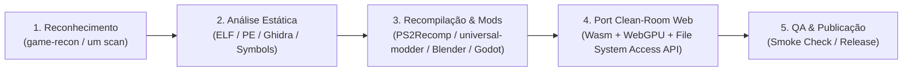

# 🔬 Reverse Engineering & Clean-Room Porting Pipeline

Documentação, playbooks e arquitetura completa para **Engenharia Reversa de Jogos, Recompilação Estática, Modding Assistido por IA e Ports Clean-Room para Navegador (WebAssembly / WebGPU)** — 100% livre de assets protegidos por copyright.

---

## 🧭 Visão Geral da Arquitetura

---

## 🛠️ Fases do Processo

### Fase 1 — Reconhecimento & Análise Estática
- **Identificação segura do alvo:** inspeção de cabeçalhos ELF/PE, tabelas de símbolos, strings e dependências sem executar binários desconhecidos fora de sandbox.
- **Mapeamento de engine e assets:** detecção automática de pipelines (PS2 Emotion Engine/IOP, Unity/Mono/IL2CPP, Unreal, Godot, DirectX/OpenGL/Vulkan).
- **Playbooks:** [`skills/engenharia-reversa-jogos/SKILL.md`](skills/engenharia-reversa-jogos/SKILL.md), [`skills/reverse-engineering/SKILL.md`](skills/reverse-engineering/SKILL.md), [`skills/game-recon/SKILL.md`](skills/game-recon/SKILL.md).

### Fase 2 — Recompilação Estática & Modding
- **Recompilação Estática (ex. PS2 → C++ nativo):** referenciando projetos open-source como [`ran-j/PS2Recomp`](https://github.com/ran-j/PS2Recomp) para traduzir instruções MIPS em código C++ compilável com CMake/Clang.
- **Orquestração de Mods:** integração conceitual com [`rehan-remade/universal-modder`](https://github.com/rehan-remade/universal-modder) (`um scan`, `um kb search`) e pipeline de assets 3D (`Blender` CLI `--background --python` + `Godot` / `Unity`).
- **Playbooks:** [`skills/mod-any-game/SKILL.md`](skills/mod-any-game/SKILL.md), [`skills/port-a-mod/SKILL.md`](skills/port-a-mod/SKILL.md), [`skills/mashup-mods/SKILL.md`](skills/mashup-mods/SKILL.md), [`skills/vr-game-modding/SKILL.md`](skills/vr-game-modding/SKILL.md).

### Fase 3 — Ports Clean-Room para Navegador (Wasm / WebGPU)
- **Zero distribuição de ROMs/ISOs/Assets:** o repositório contém apenas o motor/runtime recompilado e shims gráficos/áudio.
- **File System Access API:** o próprio usuário aponta sua cópia local legítima do jogo diretamente no navegador; nenhum arquivo protegido é enviado para servidores.
- **Playbook & Guia:** [`skills/wasm-game-ports/SKILL.md`](skills/wasm-game-ports/SKILL.md) e [`docs/ARQUITETURA_CLEAN_ROOM.md`](docs/ARQUITETURA_CLEAN_ROOM.md).

### Fase 4 — Verificação & Publicação
- Checklist de QA, testes de fumaça e empacotamento para release em [`skills/publish-mod/SKILL.md`](skills/publish-mod/SKILL.md).

---

## 🔒 Política Clean-Room & Segurança
- Este repositório **não** hospeda, redistribui nem referencia links para ROMs, ISOs, dumps (`SCUS_*`, `.bin`, `.iso`) ou chaves proprietárias.
- Todos os caminhos de sistema e variáveis são genéricos (`$HOME`, `%LOCALAPPDATA%`), sem dados pessoais ou segredos.
